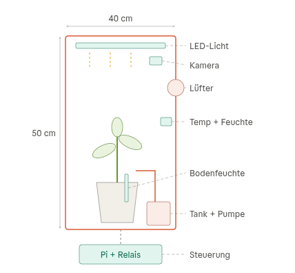

# Sprout

Ein Mini-Gewächshaus, das sich selbst um seine Pflanze kümmert. Ein Raspberry Pi misst Temperatur, Luftfeuchte und Bodenfeuchte und regelt damit Licht, Lüftung und Bewässerung. Ein Dashboard zeigt den Verlauf, eine Kamera macht Zeitraffer-Aufnahmen vom Wachstum.

Sprout ist ein gemeinsames Projekt von Maschinenbau und Informatik.

## Definition von „fertig“

> Die Pflanze überlebt eine Woche ohne uns.

Konkret: Das Basilikum kommt 7 Tage ohne Eingriff von Hand aus (außer Tank nachfüllen), und die Messwerte bleiben in den Zielbereichen unten.

## Pflanze: Basilikum

Wir starten mit Basilikum. Es wächst schnell, braucht viel Licht und zeigt Wassermangel sofort durch hängende Blätter. So sieht man schnell, ob Sprout richtig regelt.

### Zielwerte

| Größe | Zielbereich | Hinweise |
| --- | --- | --- |
| Licht | Sehr hell, mindestens 6 Stunden täglich | Ideal: Ost- oder Westfenster, im Hochsommer keine pralle Mittagssonne |
| Temperatur | 20–25 °C | Niemals unter 12 °C, keine Zugluft |
| Bodenfeuchte | 50–60 % konstant feucht | Entspricht 6–7 auf einem 1–10-Messgerät. Am besten morgens von unten gießen, Staunässe vermeiden |
| Luftfeuchte | 40–60 % | |

### So setzt Sprout die Zielwerte um

- **Licht:** LED-Pflanzenlicht nach Zeitplan, mindestens 6 Stunden am Tag
- **Temperatur:** Lüfter schaltet ein, wenn es über den Zielbereich geht; Warnung aufs Handy unter 12 °C
- **Bodenfeuchte:** Pumpe gießt von unten in den Untersetzer, bevorzugt morgens, sobald die Erde unter 50 % fällt; eine Sicherheitsgrenze verhindert Staunässe
- **Luftfeuchte:** Lüfter schaltet ein, wenn die Luftfeuchte über 60 % steigt

Alle Grenzwerte stehen später in `software/config.yaml`, nicht im Code.

## Aufbau



- Box ca. 40 × 30 × 50 cm (B × T × H) mit Plexiglas-Front und Tür
- Raspberry Pi mit BME280 (Temperatur, Luftfeuchte), kapazitivem Bodenfeuchtesensor über ADS1115, Kamera
- 4-Kanal-Relais für Pumpe, Lüfter und LED, eigene Stromversorgung für die Geräte
- Wassertank mit Pumpe und Schwimmerschalter
- Getrenntes, trockenes Elektronikfach

## Team

| Wer | Bereich |
| --- | --- |
| Chatchai ([@Chatchai-lab](https://github.com/Chatchai-lab)) | Software und Elektronik: Pi, Sensoren, Regelung, Datenbank, Dashboard, Kamera |
| Katja ([@kat-force](https://github.com/kat-force)) | Mechanik: Box, Lüftung, Bewässerung, Halterungen, Wasserschutz |

## Projektstruktur

```
sprout/
├── cad/        CAD-Modelle, Zeichnungen, Zuschnittlisten
├── software/   Python-Code für den Raspberry Pi
├── docs/       Schnittstellen, Hardware, Testprotokolle
└── deploy/     systemd-Dienste für den Pi
```

## Arbeitsweise

- Jede Aufgabe ist ein [Issue](https://github.com/Chatchai-lab/sprout/issues) mit Zielen, Schritten und Akzeptanzkriterien.
- Labels zeigen den Bereich: `gemeinsam`, `mechanik`, `software`.
- Meilensteine zeigen die Reihenfolge:
  1. Alles geplant
  2. Pi misst und pumpt
  3. Box steht, Software läuft
  4. Alles läuft
  5. Fertig zum Zeigen
- Ein Branch pro Issue, Merge über Pull Request.

## Status

In Planung. Fotos und das erste Zeitraffer-Video kommen hierher, sobald Sprout läuft.
